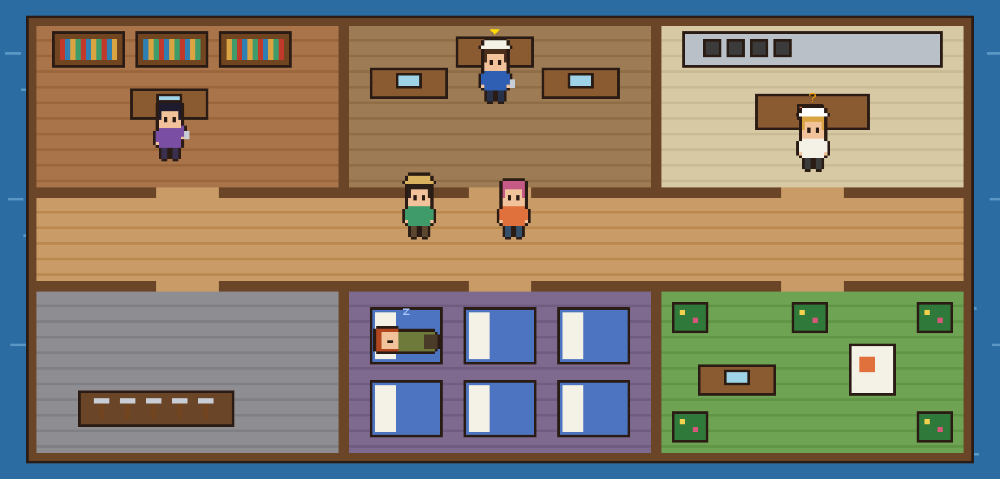

# nakama

[](https://github.com/kalyskhairy/nakama/actions/workflows/test.yml)

Several interactive `claude` (Claude Code) sessions in one terminal: every session of every folder,
their status and context use, and an optional pixel-art "office" where each session is a character
that walks, works and sleeps.



> A personal project. Unofficial, and not affiliated with Anthropic.

## Features

- Three panels: active sessions, a folder/session tree, and the chat (the real `claude`, in a PTY).
- Start new sessions or resume old ones from any folder; several accounts (`~/.claude`, `~/.claude-<name>`).
- Per session: status (waiting, working, idle), subagents, context use, tokens today and plan limits.
- A warning when a session's context is 80% full.
- A usage screen, and search through the conversations of every session.
- Notifications when a session waits for you or finishes (terminal bell; a Windows notification under WSL).
- Office (`v`): characters work at their own places, sleep in the rest room, visit the session they
  message, and the unused ones stroll the corridor. Click a character, or its name in the Crew list, to open its chat.

## Requirements

- Linux or WSL2. Only tested on WSL2; some features use `/proc`, so macOS is not supported yet.
- [Go](https://go.dev/dl/) 1.26 or newer.
- [Claude Code](https://claude.com/claude-code) (`claude`) installed and logged in.
- For the office: a terminal with **sixel** support (e.g. Windows Terminal 1.22+, WezTerm, foot).
  Without it the three panels still work.

## Install

```sh
go install github.com/kalyskhairy/nakama/cmd/nakama@latest
```

The binary lands in `$(go env GOPATH)/bin`. Make sure that folder is on your `PATH`:

```sh
echo 'export PATH="$PATH:$(go env GOPATH)/bin"' >> ~/.bashrc && source ~/.bashrc
```

From source:

```sh
git clone https://github.com/kalyskhairy/nakama.git
cd nakama
go install ./cmd/nakama
```

Then run `nakama` from any folder. The first time, pick the folders you want to see.

## Main keys

| Key | Action |
|---|---|
| `↑` `↓` / `j` `k` | select a row |
| `Tab` | switch panel |
| `Enter` | open a session / chat |
| `Ctrl+Space` | from the chat back to the lists |
| `n` | new session |
| `f` | choose folders |
| `z` | full screen chat |
| `v` | office |
| `x` | close a finished session |
| `u` | usage: plan limits, tokens per day, account and session |
| `s` | search what was said in every session |
| `F1` / `?` | full help |
| `q` | quit (**every session nakama opened stops too**; you can resume them later) |

## Options

| Option | Meaning |
|---|---|
| `--theme <name>` | office theme (default `default`) |
| `--graphics auto\|sixel\|off` | office picture |
| `--font 10x20` | cell size in pixels, if your terminal does not report it |
| `--notify=waiting,context` | which notifications: `waiting`, `finished`, `context`; `all` (default) or `none` |
| `--offline` | never fetch plan limits from the network |
| `--prefix 0x1d` | replace `Ctrl+Space` (here with `Ctrl+]`) |
| `--context-window 200000` | used for the context percentage |

## Privacy, and things to know

- nakama **reads** `~/.claude*`: session transcripts and process status. It only **writes** `~/.config/nakama`.
- To show plan limits it reads Claude Code's OAuth token and uses it **only** for one request to
  `https://api.anthropic.com/api/oauth/usage` (at most once a minute per account). The token is not
  stored, shown or logged. This endpoint is undocumented; `--offline` turns it off.
- It runs claude with `CLAUDE_CODE_FORCE_SYNC_OUTPUT=1` so the chat does not flicker.
- The transcript format, the status files and that variable are not official; a new Claude Code
  version may change them.
- Session titles appear in notifications, so mind that when sharing your screen.

## Office themes

Until you make your own, nakama draws a small **demo theme** (the picture above) into
`~/.config/nakama/themes/demo/`. To use your own, make it in `~/.config/nakama/themes/default/`
(or another name, used with `--theme`):

```
default/
├── theme.json        # copy examples/theme.json and adjust it
├── background.png    # a floor plan seen from above, PNG
└── sprites/
    ├── captain/      # made by import-sheet
    └── cook/
```

### 1. Sprite sheet

One PNG per character on a **plain magenta `#FF00FF`** background, no text or grid lines, **6 rows**
clearly apart (at least 12 empty pixels between rows, 20 between frames):

| Row | Content | Frames |
|---|---|---|
| 1 | walking down | 4 |
| 2 | walking left (rebuilt as the mirror of row 3) | 4 |
| 3 | walking right | 4 |
| 4 | walking up | 4 |
| 5 | sleeping | 2 |
| 6 | working | 4 |

```sh
nakama theme import-sheet --sheet captain.png --theme ~/.config/nakama/themes/default --name captain
```

### 2. `theme.json`

`x` and `y` are fractions 0..1 of the background; a point is where the character's **feet** are.

| Key | Meaning |
|---|---|
| `background.file`, `background.crop` | background picture; optional crop `[x, y, width, height]` |
| `charHeight` | character height relative to the background height |
| `characters` | name → sprite folder |
| `agentTypes` | agent type → character; `default` is required |
| `sessionCharacters` | optional: one character per session; the first is always taken first |
| `heights` | optional: per-character height (1 = normal) |
| `corridor` | optional: corridor nodes (at least 2, in order); the `sessionCharacters` no session uses stroll there |
| `corridorLanes` | optional: how many lanes they walk in, side by side (1 to 5, default 1) |
| `nodes`, `edges`, `entrance` | the paths characters walk; every node must be connected |
| `stations` | `work` or `rest` places; `for` lists the characters or agent types that prefer them |

You need at least one `work` and one `rest` station.

### 3. Check it

```sh
nakama theme preview --theme ~/.config/nakama/themes/default --out preview.png
```

Make sure you have the right to use the artwork you put in.

## Development

```sh
go vet ./... && go test ./... -race
```

## License

[MIT](LICENSE)
